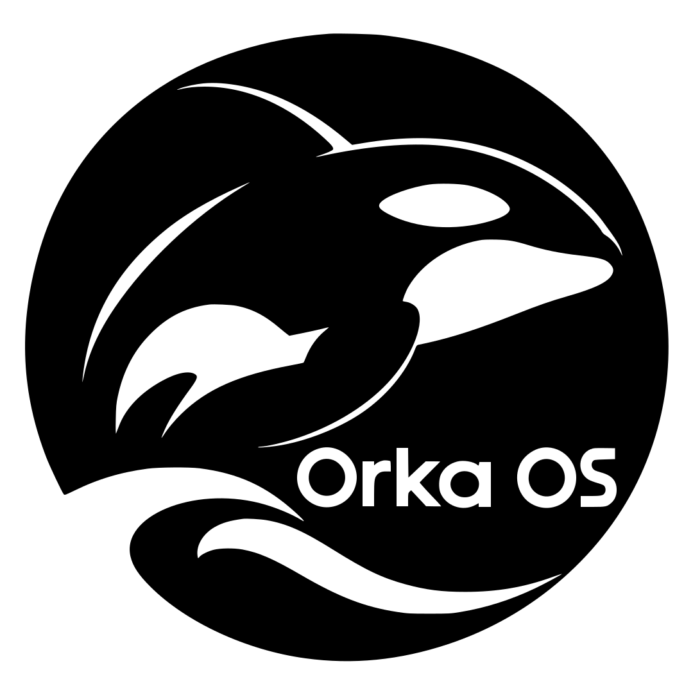
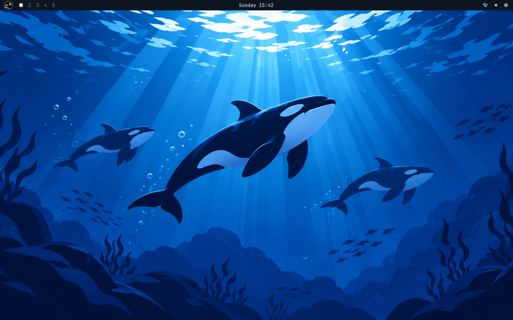
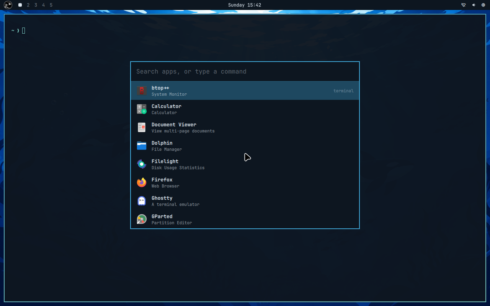
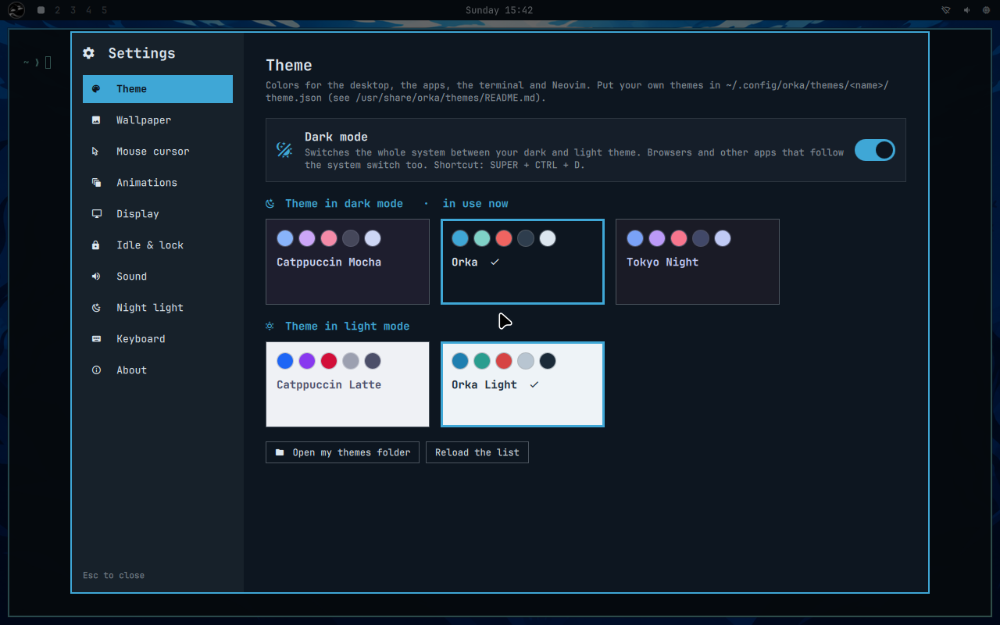
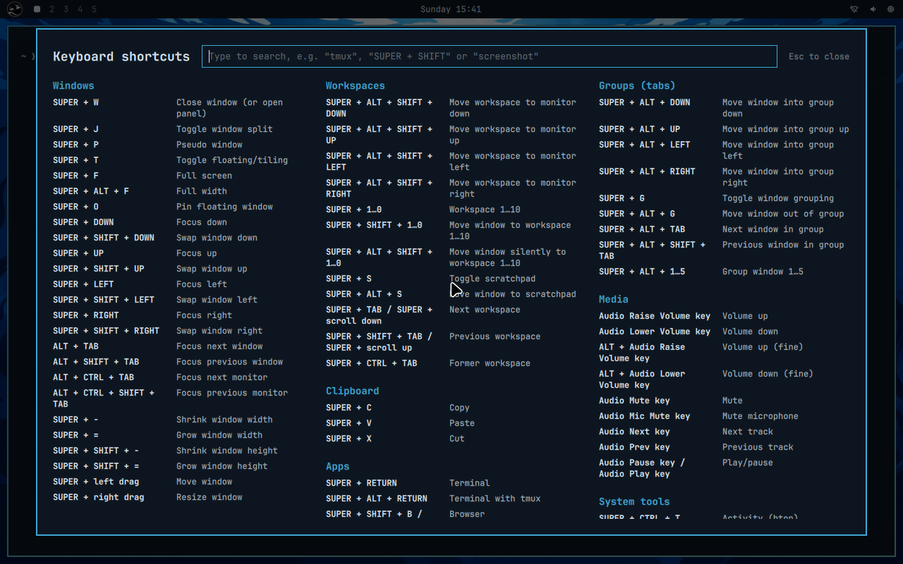

<p align="center">
  
</p>

<h1 align="center">OrkaOS</h1>

<p align="center">
  A personal Arch Linux desktop: Hyprland, a hand-built Quickshell interface and the orca-themed <b>Deep water</b> look.
</p>

<p align="center">
  
  
  
  
</p>



OrkaOS is my own Linux setup, inspired by [Omarchy](https://github.com/omacom/omarchy) but rebuilt from scratch on plain Arch: debloated, with its own name, logo, themes and desktop shell. It's made for **one machine** (see [hardware](docs/hardware-and-dual-boot.md)), dual-booted next to Windows 11, and installs **fully offline** from its own ISO.

> **Status (2026-11-10):** version 1.0, installed and running on the real PC, and **updates without reinstalling**: OrkaOS is a pacman package from this repository (latest `orka 1.0.r61`). Bugs found on the real machine are being fixed and released from the PC itself. See the [roadmap](docs/approach.md#roadmap).

## Highlights

- **Own desktop shell in Quickshell**: bar, launcher, notifications, on-screen display, lock screen, login screen, polkit agent and a searchable keyboard shortcut cheat sheet. No Waybar, Mako, Walker or SDDM.
- **Settings app**: theme, wallpaper, mouse cursor, animations, display, idle & lock, sound, night light, keyboard.
- **Themes everywhere**: Orka "Deep water" and Orka Light, plus Catppuccin and Tokyo Night. They color the shell, Ghostty, Neovim, btop, GTK and Qt apps. A **dark / light mode** switch (SUPER + CTRL + D) also tells browsers.
- **Offline installer**: one ISO with every package baked in (AUR included). Btrfs with **Snapper snapshots** you can boot into from the **Limine** menu, and Windows added to the boot menu automatically.
- **Branding**: boot screen with the logo above ripples on the water, a themed boot menu, fastfetch logo, six orca wallpapers, and the name **OrkaOS 1.0** throughout the system.
- **Orka Calculator**: our own calculator (Standard, Expert, Programmer) in Python + Qt Quick.
- **Ready-to-use terminal**: Ghostty, tmux, starship, `eza` / `zoxide` / `fzf`, and Neovim (LazyVim) working offline on the first start.

## Screenshots

| Launcher | Settings | Keyboard shortcuts |
|---|---|---|
|  |  |  |

## Essential shortcuts

| Keys | Action |
|---|---|
| `SUPER + RETURN` | Terminal (Ghostty) |
| `SUPER + SPACE` | App launcher (also runs a typed command) |
| `SUPER + K` | Every keyboard shortcut, searchable |
| `SUPER + ALT + SPACE` | Settings |
| `SUPER + W` | Close the window (or the open panel) |
| `SUPER + CTRL + D` | Dark / light mode |
| `SUPER + CTRL + L` | Lock the screen |
| `SUPER + SHIFT + S` | Screenshot of a region, copied to the clipboard |
| `PRINT` | Screenshot of a region, opened in the editor |

All bindings: [desktop](docs/desktop.md), or press `SUPER + K`.

## Building the ISO yourself

The installer ISO isn't published (it's about 3.4 GB, with every package inside so it installs offline), but you can build it yourself. Keep in mind OrkaOS is made for one machine: an AMD desktop, UEFI only, US keyboard, `Europe/Bucharest` time zone (see [hardware](docs/hardware-and-dual-boot.md)). Other hardware may need changes to `packages.txt`.

**You need** an Arch Linux system (a real install, a VM, or Arch in WSL on Windows), about 15 GB of free space, internet for the first build, and these packages:

```bash
sudo pacman -S --needed archiso base-devel git python neovim tree-sitter-cli
```

**Build:**

```bash
git clone https://github.com/bogdan9898/orka-os.git
cd orka-os
sudo ./iso/build.sh            # all stages: aur, repo, nvim, iso (the first time downloads ~3 GB)
sudo ./iso/build.sh iso        # later, after changing files: only re-assemble the ISO (~5 minutes)
```

Or without sudo, in a Docker container (nothing gets installed on your system): `iso/build-in-docker.sh` (same stages; the ISO lands in `~/dev/orka-build-out/`). See [ISO and installer](docs/iso.md#build).

The stages: `aur` builds the AUR packages from `packages-aur.txt`, `repo` downloads every official package for the offline repository, `nvim` bundles the Neovim plugins, `iso` builds the `orka` package from your working tree and assembles the ISO. Run it with `sudo` from your normal user (AUR packages are built as that user). Everything goes to `~/dev/orka-build/`; the ISO lands in `~/dev/orka-build/out/orkaos-<date>-x86_64.iso`.

**Install:** write the ISO to a USB stick (`dd`, Rufus in DD mode, or copy it onto a [Ventoy](https://www.ventoy.net) stick), turn **Secure Boot off**, and boot it. `orka-install` starts by itself and asks for the disk, hostname, user and password; no network needed. Then log in on the login screen.

**Updates** afterwards come from this repository's package repository: `sudo pacman -Syu` updates OrkaOS together with Arch ([updates](docs/updates.md)). Details on the installer, testing in a QEMU VM and the automated install test: [ISO and installer](docs/iso.md).

## Repository layout

| Path | What's in it |
|---|---|
| `iso/` | ISO build script, archiso profile, VM test scripts |
| `installer/` | `orka-install` and the few files it writes once (`target/`) |
| `pkg/` | The `orka` package (OrkaOS itself): recipe, file layout, release and repository scripts |
| `system/` | Packaged system files (services, network defaults, zram, PAM, app entries), laid out as on the system |
| `config/` | System defaults (Hyprland in Lua, bash, tmux, git) and the user files seeded on first login (`config/user/`) |
| `shell/` | The Quickshell desktop: bar, launcher, settings, lock and login screens, ... |
| `bin/` | `orka-*` commands (settings, screenshots, night light, ...) |
| `apps/` | Our own apps (Orka Calculator) |
| `themes/` | Built-in themes |
| `branding/` | Logo, wallpapers, boot screen, boot menu, fastfetch |
| `docs/` | Documentation, see below |

On the installed system the defaults live in `/usr/share/orka/` and your own files in `~/.config/` (never overwritten). Settings are stored in `~/.config/orka/settings.json`.

## Documentation

- [Approach and roadmap](docs/approach.md): own script vs. forking Omarchy, roadmap, known issues
- [ISO and installer](docs/iso.md): building the offline ISO, what the installer does, testing in QEMU, Ventoy
- [Packages](docs/packages.md): the package lists and what was dropped from Omarchy
- [Desktop](docs/desktop.md): Hyprland (Lua) config layout and key bindings
- [Quickshell](docs/quickshell.md): the bar, launcher, notifications, lock and login screens
- [Settings](docs/settings.md): the settings app, `orka-settings`, themes, wallpapers, dark / light mode
- [Shell and terminal](docs/shell.md): bash, starship, Ghostty, tmux and git
- [Neovim](docs/neovim.md): LazyVim, bundled offline
- [Calculator](docs/calculator.md): Orka Calculator
- [Branding](docs/branding.md): logo, name, boot screen, fastfetch, wallpapers
- [Updates](docs/updates.md): the `orka` package, the package repository, publishing an update, the signing key
- [Hardware and dual boot](docs/hardware-and-dual-boot.md): the target machine and the dual-boot checklist
- [Omarchy analysis](docs/omarchy-analysis.md): what Omarchy is and what we took from it

## Key decisions

| Topic | Decision |
|---|---|
| Base | Arch Linux with our own install script, not a fork of Omarchy ([why](docs/approach.md)) |
| Reference | Omarchy **v3.8.4** (MIT), the last release built from standard tools |
| Disk | Dedicated disk: 2 GiB ESP + Btrfs with Snapper snapshots, no encryption |
| Boot | Limine, with snapshot entries and Windows; kernel `linux-zen` with `linux` as fallback |
| Login | Our Quickshell greeter in greetd + cage, then Hyprland via uwsm |
| Locale | `en_US.UTF-8`, US keyboard, `Europe/Bucharest` |
| Updates | `sudo pacman -Syu`: Arch from the Arch mirrors, OrkaOS (the `orka` package) from our own signed repository, a GitHub release ([updates](docs/updates.md)) |

### Why "Orka"?

`orca` is already taken in Arch (the GNOME screen reader installs `/usr/bin/orca`) and crowded in the AUR (OrcaSlicer and about 25 others). `orka` was free in both (checked 2026-11-05). So the commands are `orka-*`, the config lives in `~/.config/orka`, and the display name is **OrkaOS**.

## License

[MIT](LICENSE). Parts adapted from Omarchy are MIT-licensed too, `Copyright (c) David Heinemeier Hansson`; that notice is kept in the [LICENSE](LICENSE) next to ours. The Omarchy name and logo are not used. The OrkaOS logo is my own design.
